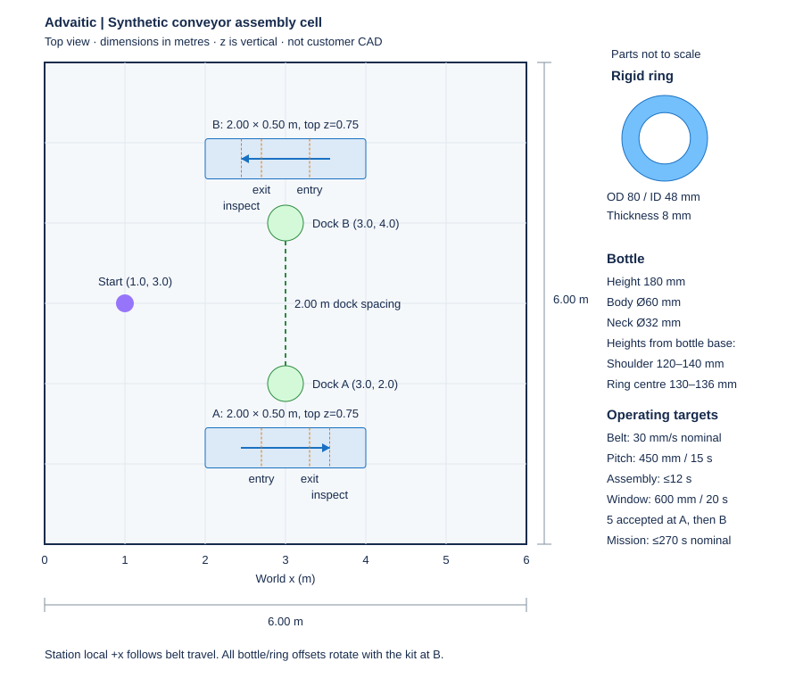
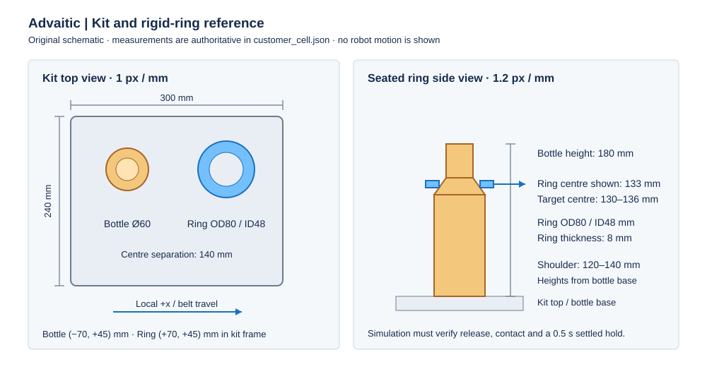

# Synthetic customer packet — revision 1

All dimensions are metres unless explicitly labelled. This packet replaces real
customer CAD so the exercise stays small. Build your own digital twin using these
dimensions; aesthetic fidelity is not assessed. You may generate CAD with AI,
download licensed assets, or use primitive geometry.

## Layout and coordinates

Room: 6 m × 6 m. World origin is the lower-left corner in the top-down drawing;
+x is right, +y is up, +z is up physically. The floor is z=0. Keep the robot
footprint inside the room and collision-free. Both conveyor tops are at z=0.75 m.

| Feature | World centre / pose | Dimensions or direction |
|---|---|---|
| Conveyor A | (3.0, 1.2, 0.75), yaw 0 | 2.0 long × 0.50 wide; travels +world x |
| Conveyor B | (3.0, 4.8, 0.75), yaw π | 2.0 long × 0.50 wide; travels −world x |
| Dock A | (3.0, 2.0), yaw −π/2 | Faces conveyor A |
| Dock B | (3.0, 4.0), yaw +π/2 | Faces conveyor B |
| Initial robot | (1.0, 3.0), yaw 0 | Entire mission begins here |

Station local x follows belt travel and local y is rotated with the station frame.
The ring/bottle offsets rotate with the kit; do not accidentally use A's world
offsets unchanged at B. The diagram is dimensioned in [layout.svg](../assets/layout.svg).

## Product, kit and workholding

| Part | Dimensions |
|---|---|
| Kit | 300 × 240 × 25 mm; top supports the bottle base |
| Bottle body | Diameter 60 mm; straight body from base z=0 to 120 mm |
| Bottle shoulder | Frustum from radius 30 mm at z=120 to radius 16 mm at z=140 |
| Bottle neck | Diameter 32 mm from z=140 to 180 mm; total height 180 mm |
| Rigid ring | OD 80 mm, ID 48 mm, thickness 8 mm, mass 40 g |
| Bottle position in kit | x=−70 mm, y=+45 mm |
| Ring initial position in kit | x=+70 mm, y=+45 mm; lies flat on kit top |

Kit frame origin is its plan centre at its top surface; nominal kit top is z=0.775 m
when its bottom rests on the belt. Ring centre initially sits 4 mm above that top.
Bottle base is on the top. The bottle can be retained in the kit; the ring must
be independently picked, moved and released. Bottle mass is 150 g if modelled as
dynamic. A ring made from compound colliders must preserve the hole. Do not use
one convex hull that fills it.

Acceptance is measured relative to the moving bottle base, not world z. Ring
centre radial error ≤4 mm, centre height 130–136 mm, tilt ≤10°, continuous valid
settled seating for ≥0.5 s, released from robot, in bottle contact, not supported
by the kit. The shoulder is deliberately generous: this is a rigid-ring exercise,
not thread engagement or a flexible seal insertion task.

## Conveyor and feeder

Nominal speed 30 mm/s; test range 25–35 mm/s; pitch 450 mm. Define arrival when
the **bottle centre** crosses station local x=−300 mm. The bottle work window ends
at x=+300 mm; inspection happens at x=+550 mm. Keep the belt moving during nominal
assembly and human interruptions. Do not make it pause to solve the task.

Use a feeder that releases kits only after the robot is ready at that station.
Inactive belts keep moving but can run empty. At a station, maintain
`accepted + in_flight <= 5`. A rejected downstream kit frees a slot for a replacement,
which is released at the next available pitch. This avoids silently discarding
an endless stream while the robot is travelling. Kit IDs are unique across both
stations. On switching, the next station's feeder starts a fresh five-kit batch.

## Robot and sensors

Prefer a compact AMR (footprint at most roughly 650 × 650 mm) with one arm of at
least roughly 800 mm reach. Verify your actual reach and collision clearance;
these are selection hints, not supplied kinematic proof. If your documented robot
needs a slightly different dock, request/record the change rather than changing
the specification in secret.

For robot models, browse
[MuJoCo Menagerie's mobile manipulators](https://github.com/google-deepmind/mujoco_menagerie#mobile-manipulators).
For optional scene meshes, browse [Gazebo Fuel](https://app.gazebosim.org/fuel/models);
Gazebo assets may need conversion for MuJoCo. These are starting points, not
validated fits. Check each model's licence, dimensions, reach and collision
geometry. Primitive conveyors and the supplied ring/bottle fixture are enough.

Simulate wheel odometry, IMU, navigation LiDAR, one RGB-D camera, and conveyor
encoder/arrival signals. Sensor models may be simple. Ground-truth inspection is
allowed on the customer side; robot control should consume sensor estimates or
the explicitly supplied line signals. If perception is unfinished, provide a
clearly labelled oracle mode and report it separately from sensor-driven results.

Dock within 25 mm and 2°. Assembly base speed ≤10 mm/s; travel speed ≤350 mm/s,
yaw rate ≤0.6 rad/s. Stow arm before undocking. Known static maps are allowed;
localize, plan, move, stop and dock rather than writing a new base pose.

## Timing proposal

Use 12 s assembly cycle and 270 s nominal mission limit. `systems-timing` prints
the assumptions: six short Cartesian moves at 0.25 m/s and 0.5 m/s², grip/release,
settling, sensing/tracking overhead, and 25% reserve. The estimate fits 12 s; the
nominal work window is 20 s and arrivals are 15 s apart.

At 35 mm/s the window is 17.14 s and arrivals are 12.86 s apart, so timing margin
is smaller. Size and test against this range. At nominal speed, fifth inspection
occurs about 88.33 s after the first arrival. Two batches therefore use about
176.67 s before travel/docking. At the slowest test speed (25 mm/s), the two batches
need 212 s. Adding 45 s for initial approach, station travel and docking gives
257 s, leaving 13 s within the 270 s limit. This is a sizing calculation, not a
measured full-system result.

Report cycle time from work-entry crossing to the end of the first valid 0.5 s
released seating hold. Report downstream inspection delay, station change time,
total mission time, rejects,
and effective throughput separately. Do not quote 5 assemblies/minute as overall
throughput: the nominal arrival rate is only 4/minute even before travel.

## Human and integration interruptions

Detect a person within 1 m of the mobile base footprint or within the active
station's interaction zone. Document that zone and the simulated sensor used.
Issue stop within 200 ms, settle robot base and end-effector speeds to ≤0.01 m/s
within 1 s, and hold until clear plus explicit resume acknowledgement. Belt motion
continues, so any affected kit must be re-observed and safely completed within its
remaining window, or rejected and replaced. Never count an interrupted attempt
as accepted just because the robot had sent a completion message.

Recover a dropped PLC acknowledgement with the same sequence and payload. The
customer inspection remains the authority for acceptance. Include a real socket
timeout/reconnect test, not merely a log line saying a failure occurred.
